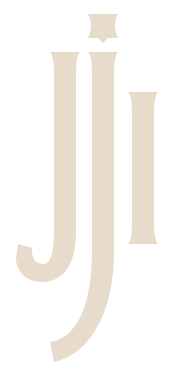

<p align="center">
  
</p>

<h1 align="center">Jukejoint</h1>

<p align="center">Community lobbies for playing custom Deadlock modes together.</p>

<p align="center">
  <a href="https://github.com/axiumhq/jukejoint/actions/workflows/ci.yml"></a>
  <a href="https://github.com/axiumhq/jukejoint/releases/latest"></a>
  <a href="LICENSE"></a>
  
</p>

**Jukejoint** is an independent project for the Deadlock community in Brazil and Latin America. Use the website or Windows app to find a lobby, sign in through Steam, and launch a custom mode.

The game runs on the lobby host's computer. Other players connect directly over P2P. Jukejoint's API handles sign-in, lobby listings, and the signaling players need to find each other. The app uses [Modlock](https://github.com/paralin/modlock), pinned to a specific version and verified by SHA-256.

> Jukejoint is proprietary software. Its source code is public for inspection and release transparency. Making this repository public does not grant permission to use, modify, or redistribute the software. See [LICENSE](LICENSE) and [CONTRIBUTING.md](CONTRIBUTING.md).

Jukejoint is not affiliated with Valve. Deadlock is a trademark of Valve Corporation.

## Download

Download the latest Windows installer from the [releases page](https://github.com/axiumhq/jukejoint/releases/latest). The installer includes the app, available modes, and the Modlock version pinned for that release. The app checks for updates before opening its main window.

## Available modes

| Mode | Status |
| --- | --- |
| Duelo à Meia-Noite | Playable 1v1 mode with best-of-five matches and a shared hero selection. |
| Campo de Treino | Playable practice mode with targets and training commands. |
| Círculo Profano, Último Bonde, Neblina, and Cerco ao Cofre | Listed in the catalog, but currently launch the test mode. |

Modes live in `spike/mods/`. Each mode has its own README with instructions and test coverage.

## How it works

```text
Website and Windows app
        │
        ├── API: Steam sign-in, lobbies, presence, and invites
        └── Modlock: starts the mode and connects computers over P2P

API and signaling: hosted on the project's Raspberry Pi
```

The website (`web/`) and desktop app (`desktop/`) use the Go API (`server/`). The signaling service (`spike/signal/`) helps Modlock processes establish a P2P connection. The API and signaling service run as Docker images published to GHCR; deployment configuration lives in [`axiumhq/infra-pi`](https://github.com/axiumhq/infra-pi).

## Run locally

### Website with demo data

Requires Node.js 24 and npm.

```bash
npm ci --prefix web
npm run dev --prefix web
```

Open `http://localhost:5173`. Without `VITE_API_URL`, the website uses simulated data.

### Website with a local API

Requires the Go version specified in `server/go.mod`.

```bash
cd server
DEV_LOGIN=1 go run .
```

In another terminal:

```bash
npm ci --prefix web
VITE_API_URL=http://localhost:8090 npm run dev --prefix web
```

`DEV_LOGIN=1` is for local development only. See [`server/README.md`](server/README.md) for Steam authentication and other configuration.

### Desktop app

The desktop app is developed and packaged for Windows. It requires Node.js 24, Rust 1.99.1, MSVC Build Tools 2022, the Windows SDK, and WebView2.

```powershell
npm ci --prefix web
npm ci --prefix desktop
powershell -ExecutionPolicy Bypass -File scripts\install-modlock.ps1
$env:MODLOCK_BIN = "$PWD\tools\modlock-v0.1.73\modlock.exe"
cd desktop
npx tauri dev
```

Deadlock must be installed through Steam to launch a mode in-game. See [`desktop/README.md`](desktop/README.md) for development, configuration, and build details.

## Repository layout

| Path | Contents |
| --- | --- |
| `web/` | React, Vite, and TypeScript website, also loaded by the desktop app. |
| `desktop/` | App interface and Tauri/Rust integration with the system and Modlock. |
| `server/` | Go API for Steam sign-in, lobbies, presence, and invites. |
| `spike/signal/` | Go P2P signaling service. |
| `spike/mods/` | Custom modes and their tests. |
| `scripts/` | Modlock installation and local build/test helpers. |
| `docs/` | Architecture decisions, integration, design, and audits. |
| `.github/workflows/` | CI, merge queue, release builds, and server images. |

The local `tools/` directory is not tracked by Git. The installation script downloads the expected Modlock version and verifies its hash before use.

## Checks

These are the main local checks. The CI workflow selects checks based on the paths changed in a pull request.

| Area | Command |
| --- | --- |
| Website | `npm test --prefix web` and `npm run build --prefix web` |
| Desktop frontend | `npm run typecheck --prefix desktop` |
| Desktop Rust | `cargo test --manifest-path desktop/src-tauri/Cargo.toml` |
| API | `cd server && go vet ./... && go test ./...` |
| Signaling | `cd spike/signal && go vet ./... && go test ./...` |

## CI and releases

- The `CI` workflow runs checks for changed areas and provides an aggregate status for pull requests.
- Approved pull requests with passing CI can enter the merge queue.
- The release workflow creates releases and calculates versions from classified changes.
- The desktop build publishes the Windows installer, updater signature, and `latest.json` to the release.
- The image workflow publishes the API and signaling images to GHCR and opens an update pull request in `infra-pi`.

See [GitHub Actions](https://github.com/axiumhq/jukejoint/actions) for current workflow status and [releases](https://github.com/axiumhq/jukejoint/releases) for published artifacts.

## Contributing

Pull requests are welcome. Read [CONTRIBUTING.md](CONTRIBUTING.md) first for the contribution process and the rights granted for accepted contributions. Jukejoint remains proprietary software.

## Documentation

- [Desktop app](desktop/README.md)
- [API](server/README.md)
- [Signaling service](spike/signal/README.md)
- [Platform decision](docs/decisao-plataforma.md)
- [Modlock adapter](docs/engine-adapter.md)
- [First two-computer test](docs/spike-fase-0.md)
